# Hi, I'm Zeeshan Imdad 👋

### Lead Backend Engineer at ADCB · Payments, event streaming & agentic AI

## 🧑‍💻 About me

I build backend systems for payments, event streaming and agentic AI, and lead a team of six engineers at **ADCB** in Abu Dhabi.

Right now I own card and wallet payment services and a multi-agent AI Operations Copilot that on-call engineers use during live incidents. Before ADCB I built observability services at SolarWinds, banking integrations at Publicis Sapient, and a telemetry ingestion pipeline at Wipro.

## 🚀 Selected work

Most of my production work is proprietary. Case studies with architecture diagrams are on my **[portfolio](https://xeeshan16.github.io)**.

- 🤖 **AI Operations Copilot**: LangGraph multi-agent assistant with a validation gate and human sign-off on every action. ~60% lower MTTR across 10 banking services.
- 💳 **Payment orchestration**: Kafka- and SQS-driven architecture with idempotent consumers, back-pressure and circuit breakers for 100K+ card and payment transactions.
- 📈 **Observability platform**: Go stream processors and Java ETL workers feeding ClickHouse with sub-second p99 queries, plus streaming anomaly detection alerting on a 1-second cadence.
- 🛰️ **Telemetry ingestion**: Go, Kafka and Redis pipeline on Kubernetes that absorbed 4x traffic growth at 99.95% availability.

## 📂 Projects on GitHub

| Project | What it is |
| --- | --- |
| 💸 **[payment-simulator](https://github.com/xeeshan16/payment-simulator)** | Synthetic payment service in Go: idempotent transfers, double-entry ledger, transactional outbox to Kafka and an idempotent consumer with a dead-letter topic. Integration-tested against real Postgres. |
| 🧰 **[devtools-hub](https://github.com/xeeshan16/devtools-hub)** | Privacy-first developer utilities (JSON, JWT, regex, cron, diff, token counter and more), all client-side. Next.js and TypeScript. [Live site](https://devtools-hub-sigma.vercel.app) |
| 🗂️ **[Portfolio](https://github.com/xeeshan16/xeeshan16.github.io)** | Astro site with case studies and architecture diagrams, deployed to GitHub Pages. |

## 🛠️ Tech stack

  

  
  
  
  
  
  
  
  
  
  

## 📊 GitHub stats

  

## 🏆 Certifications and recognition

- 🎓 **Oracle**: Certified Professional Java · OCI Multicloud Architect Professional · OCI Generative AI Professional · OCI Developer Professional · AI Vector Search Professional
- 📨 **Confluent**: Apache Kafka Fundamentals
- 🧠 **Competitive programming**: 1000+ problems solved on LeetCode and GeeksforGeeks · 2nd place regionally, ICPAC · 3rd place, HOWATHON 2022

## 💬 Quote of the day

  

**Open to senior backend and AI platform roles in the UAE, Europe, UK and New Zealand.**

